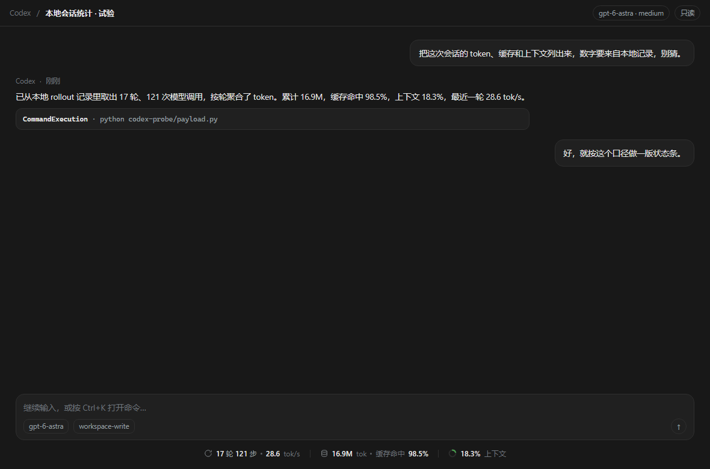
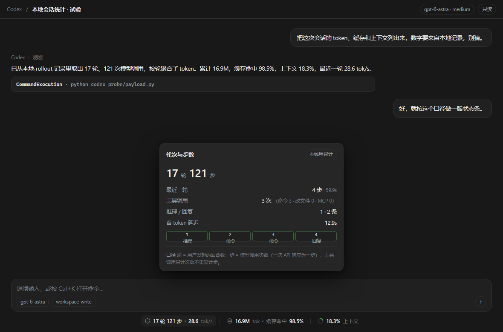
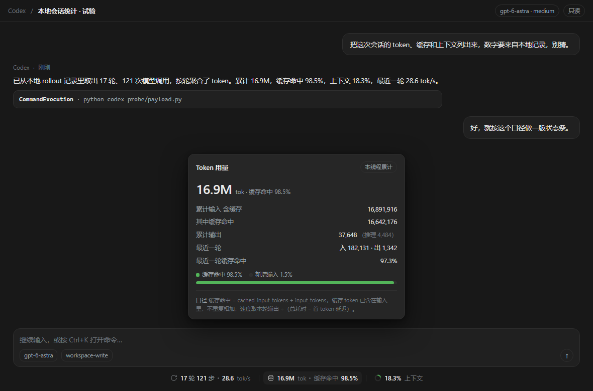
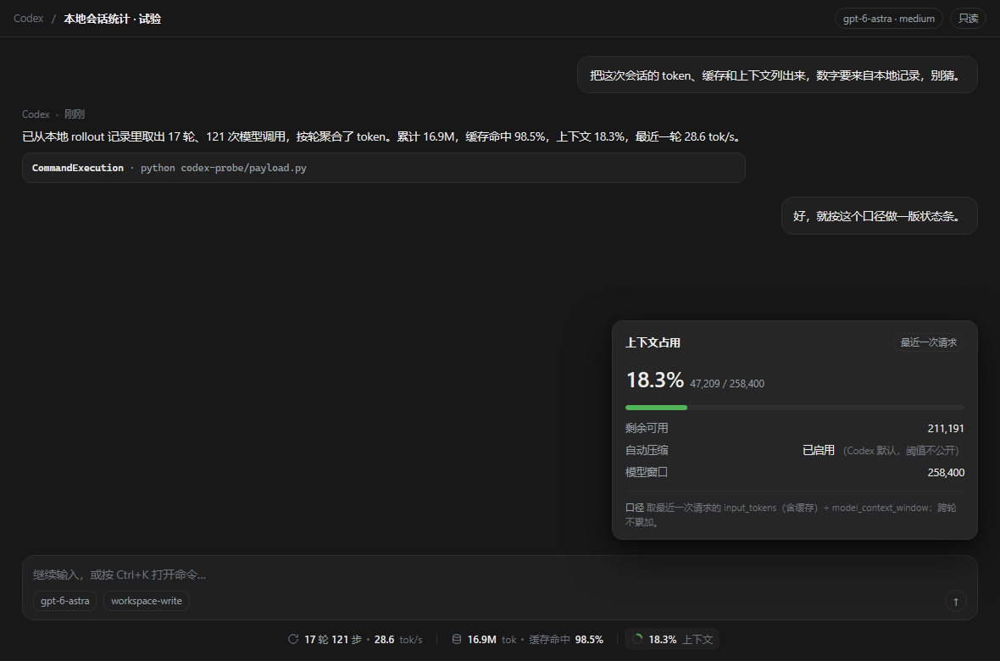
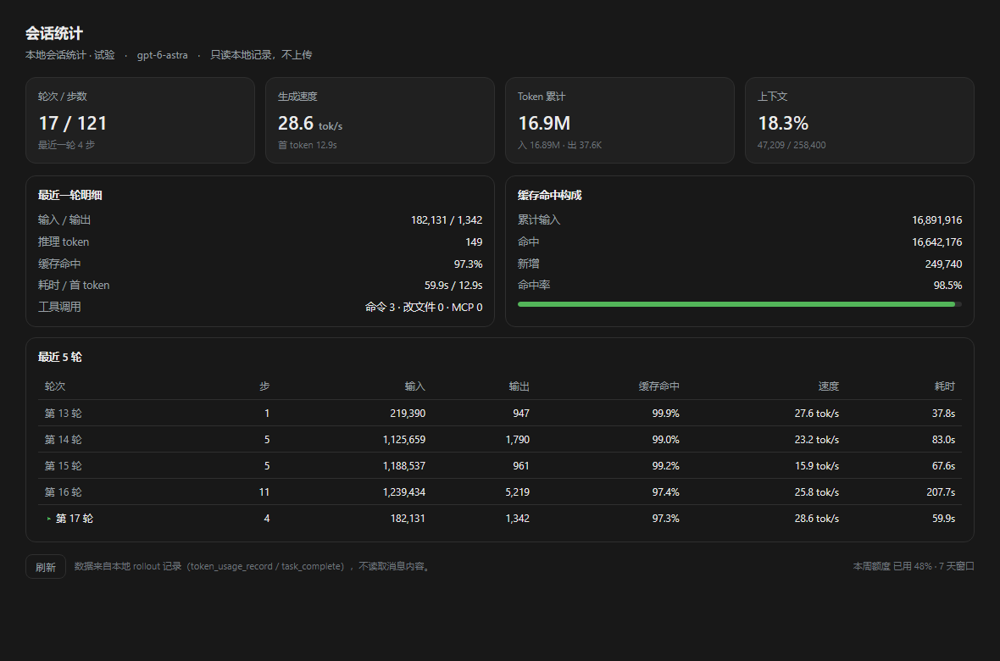
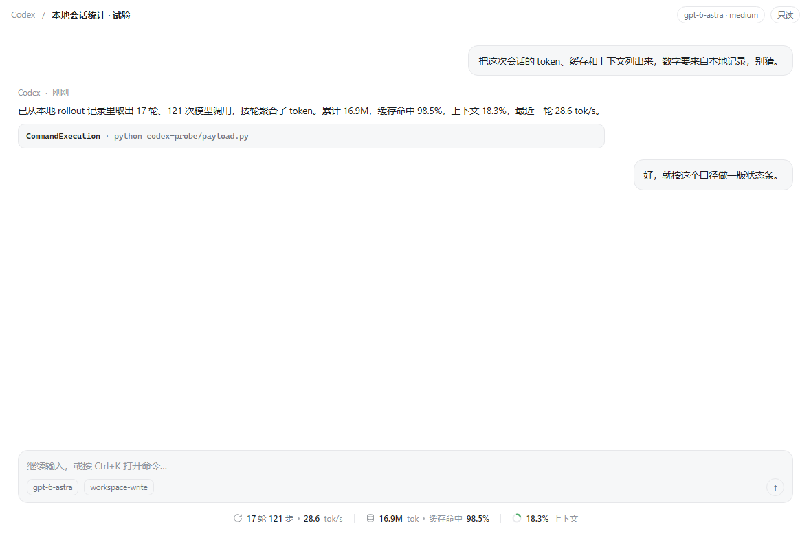
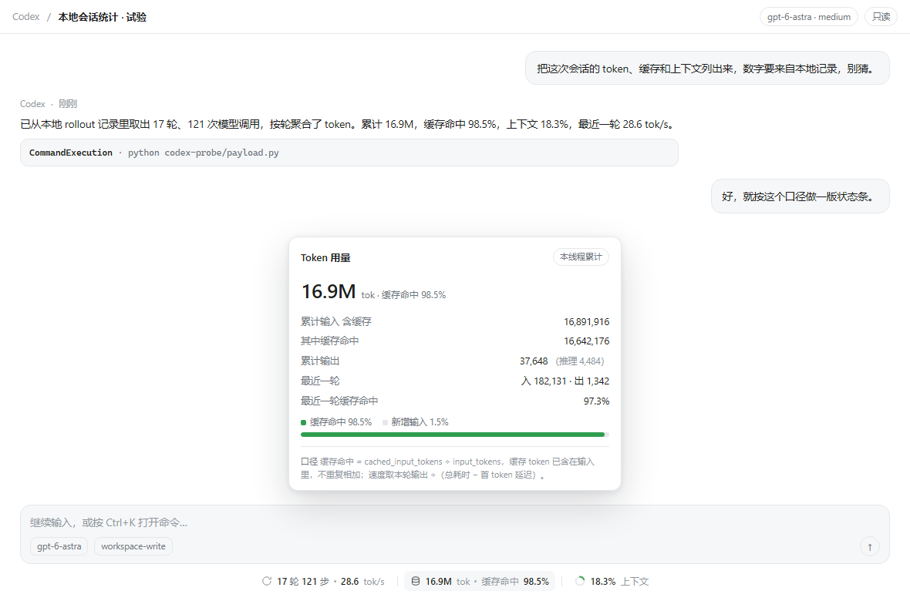

# Codex 桌面版「会话仪表盘」设计稿

> 这是 2026-11-16 的原始设计稿，用于保留当时的取舍与依据，**不是当前实现说明**。
> 当前能力、验证版本与测试覆盖请见 `README.md`、`CHANGELOG.md`、`verify/SURFACES.md`。
> 文中的版本号与截图都对应当时（26.1111.2228.0 / 早期形态）；底栏后来改成了通栏，
> 面板也从两页扩到四页（概览 / 统计 / 轨迹 / 代理）。


v0.1 · 2026-11-16 · 参照 DSH Web GUI 对话底栏

---

## 一、结论先行

**可以做，但要先接受三个边界：**

1. **位置**——Codex 桌面版（MSIX 安装的 ChatGPT 应用，当时版本 `OpenAI.Codex 26.1111.2228.0`）没有官方的「常驻底栏」扩展点。官方开放的 UI 扩展只有插件（MCP App 面板，渲染在会话内容里）。
2. **实时性**——速度只能算「本轮均值」（输出 token ÷ 生成耗时），拿不到流式过程中的瞬时 tok/s；数据源是落盘记录，天然有约 1–2 秒延迟。
3. **1:1 视觉只能靠注入**——想让它真的长在输入框下面、点开弹详情，只能走 CDP 注入（你之前的 `composer-once-v3` 已验证可行），代价是每次要带调试端口启动，应用一升级就失效。

**建议：先做「面板版」**（官方、稳定、1–2 天可交付），底栏版留作可选实验。

---

## 二、参照物：DSH 底栏的三项

| 项 | 折叠态 | 点开详情 |
|---|---|---|
| 轮次 / 步数 / 速度 | `17 轮 121 步 · 28.6 tok/s` | 本轮各步、工具调用、首 token 延迟 |
| Token 用量 | `16.9M tok · 缓存命中 98.5%` | 输入 / 输出 / 缓存拆分，最近一轮 |
| 上下文占用 | `18.3%` 环形 | 已用 / 窗口 / 剩余 / 压缩状态 |

设计原则取自 DSH：**默认一行、无边框、低对比；数字加粗、单位变淡；每项可点开；同一时间只开一个。**

---

## 三、Codex 能拿到哪些数（本机已实测）

两个数据源，全部只读：

- `~/.codex/state_5.sqlite` → `threads` 表（`id`、`rollout_path`、`title`、`tokens_used`、`model`、`updated_at`…）
- rollout JSONL：`~/.codex/sessions/YYYY/MM/DD/rollout-*.jsonl`

| 指标 | 数据来源 | 精度 |
|---|---|---|
| 轮数 | `event_msg/task_started` 的 `turn_attribution.turn_trigger`（`composer` = 用户发起） | 准 |
| 步数 | `token_usage_record` 按 `turn_id` 计数（= 本轮模型调用次数） | 准 |
| 工具调用 | `event_msg/item_completed.item.type`：`CommandExecution` / `FileChange` / `McpToolCall` / `Reasoning` / `AgentMessage` | 准 |
| 本轮速度 | `output_tokens ÷ ((duration_ms − time_to_first_token_ms) ÷ 1000)`（来自 `task_complete`） | 轮均，非瞬时 |
| 首 token 延迟 | `task_complete.time_to_first_token_ms` | 准 |
| 累计 token | `token_count.info.total_token_usage` 或 `threads.tokens_used` | 准 |
| 缓存命中 | `cached_input_tokens ÷ input_tokens`（缓存已含在输入内，不重复相加） | 准 |
| 上下文 | `last_token_usage.input_tokens ÷ model_context_window` | 准，按最近一次请求 |
| 额度（可选第 4 项） | `token_count.rate_limits.primary.used_percent` + `resets_at`（7 天窗口） | 准 |
| 压缩 | `compacted` 记录 / `ContextCompaction` item | 准 |

**已知限制**

- 没有流式中途计数 → 速度只能是轮均或单次响应均。
- `token_count` 是每次请求结束后追加，界面刷新延迟约 1–2 秒。
- **会话绑定已经查清**：Codex 每次 `tools/call` 都会在 `_meta` 里下发 `threadId`（同时有 `x-codex-turn-metadata.thread_id` / `session_id` / `call_id`），服务端直接读即可，不需要手动选择、也不需要注入。实测与版本兼容性见附录 E。
- 原生已有一个「上下文占用」提示：`[desktop] show-context-window-usage`（你本机已开）。它是今天最接近第三项的东西，但不可点开、不可加项、样式不可调。

**真实样本**（thread `01a1e207…`，`gpt-6-astra`，数据取自本机记录）：

```
17 轮 / 121 步 · 28.6 tok/s
16.9M tok · 缓存命中 98.5%
上下文 18.3%（47,209 / 258,400）
本周额度 48%
```

---

## 四、视觉稿

### 4.1 折叠态（深色）



底栏紧贴输入框下方，三组指标居中，分隔符为 1px 竖线。数字 `17 / 121 / 28.6` 加重，单位 `轮 / 步 / tok/s` 压灰。

### 4.2 点开：轮次与步数



- 大数字给结论（17 轮 / 121 步），下面才是明细。
- 底部一行小方块是「本轮 4 步」的时间线：推理 → 命令 → 命令 → 回复。
- 口径写在最底下，避免把「步」误读成工具次数。

### 4.3 点开：Token 用量



- 缓存命中做成进度条 + 图例，98.5% 一眼看出是「几乎全是缓存」。
- 明确标注「缓存已含在输入内」，防止被当成额外消耗。

### 4.4 点开：上下文占用



- 右侧弹出（靠近右下角触发区），显示剩余、自动压缩状态、模型窗口。

### 4.5 面板版（官方路线，可落地）



四张指标卡 + 两块明细 + 最近 5 轮表格。这是**今天就能做进 Codex 的形态**（MCP App），不是常驻底栏。

### 4.6 浅色主题





---

## 五、视觉与交互规格

| 项 | 值 |
|---|---|
| 底栏字号 / 行高 | 12px / 1.5，`tabular-nums` |
| 图标 | 14×14，1.6px stroke，`currentColor` |
| 项内间距 | 6px；项间 4px + 1×13 分隔线 |
| 悬停 | 底色 `#202020`（浅色 `#f6f7f8`），文字提亮 |
| 展开块 | 宽 432px，圆角 12，距底栏 8px，投影 `0 18px 50px rgba(0,0,0,.55)` |
| 强调色 | 深色 `#53b559` / 浅色 `#2f9e4f`；上下文环按 70% / 90% 转黄、红 |
| 深色底 | `#181818` / 面板 `#202020` / 描边 `#2f2f2f` |
| 浅色底 | `#ffffff` / 面板 `#f6f7f8` / 描边 `#e6e7ea` |

**交互**

- 默认折叠；悬停高亮；点击展开，同时只开一个。
- `Esc` 或点击外部关闭；`Tab` 可聚焦，`Enter` / `Space` 展开。
- 数据只在「一轮结束」时刷新，数字不滚动动画，避免闪烁。
- 无数据时显示 `—`，不显示 0，避免误导。

---

## 六、三条落地路线

| | A. 面板版（MCP App） | B. 常驻底栏（CDP 注入） | C. 外部悬浮窗 |
|---|---|---|---|
| 形态 | 会话内卡片 / 全屏面板 | 输入框下方常驻条 + 弹层 | 独立小窗，置顶 |
| 官方支持 | ✅ 官方插件机制 | ❌ 非官方 | ✅ 不碰应用 |
| 升级安全性 | 高 | 低（版本一变就失效） | 高 |
| 需要改启动参数 | 否 | 是（`--remote-debugging-port`） | 否 |
| 工作量 | 1–2 天 | 3–5 天（原型已完成大半） | 2–3 天 |
| 与 DSH 相似度 | 中（是面板不是底栏） | 高（几乎 1:1） | 中 |

**推荐顺序：A → C →（可选）B。** 先把数据口径和视觉定下来，A 能最快跑通；C 补上「随时可见」；B 只在你能接受调试端口启动方式时再做。

---

## 七、可复用什么

你现有的 `codex-token-panel-prototype`（已安装为 `local-token-panel-prototype@local-token-panel-test`）已经具备：

- MCP 协议骨架（`initialize` / `tools/list` / `resources/read` / `tools/call`）
- 只读读取 `state_5.sqlite` + rollout 的解析逻辑
- MCP App 面板的 HTML 渲染与 `postMessage` 通信

还缺：

1. 会话识别改为直接读 `_meta.threadId`（原型里的 `binding.json` 硬绑定可以删掉）
2. 本轮速度、缓存命中率、上下文占用三个字段
3. 点击展开的交互与主题适配
4. 面板里的「最近 N 轮」表格

---

## 八、需要你定的四件事

1. **先做哪条路线**（建议 A）
2. **`_meta` 缺失时的兜底**：手动选择 / 最近活跃 / 显示「无法绑定」并提示重启
3. **要不要「额度」作为第四项**（数据已有，本周已用 48%）
4. **界面语言**：中文 / 中英双语

---

## 附录 A：复现方式

```powershell
# 1) 取当前线程的仪表盘数据（只读）
python codex-dashboard\probe\payload.py

# 2) 重新生成静态稿
python codex-dashboard\probe\render_variants.py
#    再用浏览器打开 codex-dashboard\variants\*.html

# 3) 交互预览（真实悬停/点击）
#    浏览器打开 codex-dashboard\mockup.html#tokens-dark
```

## 附录 B：字段样例（精简）

```json
{ "type": "event_msg",
  "payload": { "type": "token_count",
    "info": { "last_token_usage":   { "input_tokens": 182131, "cached_input_tokens": 177280,
                                      "output_tokens": 1342, "reasoning_output_tokens": 149,
                                      "total_tokens": 183473 },
              "total_token_usage":  { "total_tokens": 16929564, "input_tokens": 16891916,
                                      "cached_input_tokens": 16642176, "output_tokens": 37648 },
              "model_context_window": 258400 } } }
```

```json
{ "type": "event_msg",
  "payload": { "type": "task_complete", "turn_id": "…",
                "duration_ms": 59919, "time_to_first_token_ms": 12929 } }
```

```json
{ "type": "token_usage_record",
  "payload": { "turn_id": "…", "turn_token_usage": { "output_tokens": 1342, "…": "…" },
                "thread_token_usage": { "total_tokens": 16929564, "…": "…" } } }
```

## 附录 C：验证记录与未验证项

**已验证（本机实测）**

- `state_5.sqlite` 可只读打开，`threads` 表含 `rollout_path`、`tokens_used`、`model`。
- rollout JSONL 中 `token_usage_record`、`task_complete`、`item_completed`、`rate_limits` 字段齐全，可还原全部三项指标与额度。
- 上述真实样本数字由 `probe/payload.py` 直接算出，非人工填的示意值。
- 静态稿由无头 Edge 渲染，深/浅两套均已出图。

**未验证**

- 面板版在 Codex 内的实际渲染效果（你的原型验证记录里也标注「Actual UI render remains unverified」）。
- CDP 注入底栏在此版本上的持久性。
- 当时桌面版 `26.1111.2228.0` 是否与本机 CLI 同版本地带上 `_meta.threadId`（附录 E 已实测通过，当前版本 26.1120.5083.0 同样可用，见 README）。

## 附录 D：外部资料

- Codex 插件 / 状态栏能力：[codex-hud](https://github.com/brandonwie/codex-hud)、[oh-my-codex HUD 说明](https://github.com/yeachan-heo/oh-my-codex/blob/2e3e629617899c867049e4979ef1355cdea94e9f/skills/hud/SKILL.md)
- Codex CLI 自定义状态栏 PR：[openai/codex#10170](https://github.com/openai/codex/pull/10170)
- 关于默认状态栏不支持自定义命令与速度的说明：[tecyfy](https://tecyfy.com/blog/tokens-per-second-claude-code-codex)

## 附录 E：会话绑定机制（2026-11-16 查证）

**结论：Codex 官方就会在每次 MCP `tools/call` 上盖会话 ID，服务端直接读 `_meta` 即可。**

取法（优先级从高到低）：

1. `_meta["threadId"]`（camelCase，Codex ≥0.160 对每个 tools/call 都盖）
2. `_meta["thread_id"]`
3. `_meta["x-codex-turn-metadata"]` 里的 `thread_id`（该键的值是 JSON 对象或 JSON 字符串，字段为 `thread_id` / `turn_id`）
4. 面板刷新时由前端回传上一次拿到的 `thread_id`（兜底）

不要用 `sessionId` / `session_id`：那是本次运行的临时 ID，重启就变。

**证据链**

- codex-rs `core/src/mcp_tool_call.rs`：`build_mcp_tool_call_request_meta` 写入 `x-codex-turn-metadata`、`callId`，`with_mcp_tool_call_ids_meta` 再无条件写入 thread_id / session_id；对第三方 MCP server 同样生效。
- 本机 `codex.exe` 中检索到 `x-codex-turn-metadata`、`threadId`、`turnId`、`callId` 等符号；`app.asar` 的 MCP host 用 schema `{thread_id?, turn_id?}` 解析 `x-codex-turn-metadata`。
- 第三方项目已实测并在 PR 中写明：Codex ≥0.160 通过 `_meta.threadId` 在每次 tools/call 上盖真实 thread id（[billion-context#2026](https://github.com/ranxianglei/billion-context/pull/2026)、[#2027](https://github.com/ranxianglei/billion-context/pull/2027)），并有 0.161 / 0.166 的实测记录（[参考](https://github.com/notfounnd/marc-server/blob/5110ebd4b54e9f93b2d3d2707f95e812a6aa5ada/.marc/threads/oportunidade-mecanismo-de-evento-para-agentes-nao-precisarem-de--a54ceabc/artifacts/evidencias-codex-mcp-windows-20261031.md)）。

**现场实测结果（2026-11-16 16:34，桌面版引擎 `0.169.0-alpha.11.1`）**

给原型的 `server-v3.py` 加了一行 `_meta` 落盘日志，重启 Codex 后在各会话点开面板，收到的原始请求：

```json
{ "method": "tools/call",
  "params": { "_meta": { "thread_id": "01a1c889-48e8-7562-b2af-022d317fac95",
                         "threadId":  "01a1c889-48e8-7562-b2af-022d317fac95" },
              "name": "show_local_token_panel", "arguments": {} } }
```

- `threadId` 与 `thread_id` 都带，值就是当前会话 UUID。
- `resources/read`（拉面板 HTML）没有会话信息，`tools/list` 只有 `traceparent`，所以**数据必须走 `tools/call` 返回**，面板静态资源本身拿不到 thread。
- 本次样本里没有 `session_id`；`x-codex-turn-metadata` 这次未出现，读取顺序仍然保留它作兜底。

结论：绑定方案成立，代码里直接取 `_meta["threadId"]`，删掉 `binding.json` 即可。

